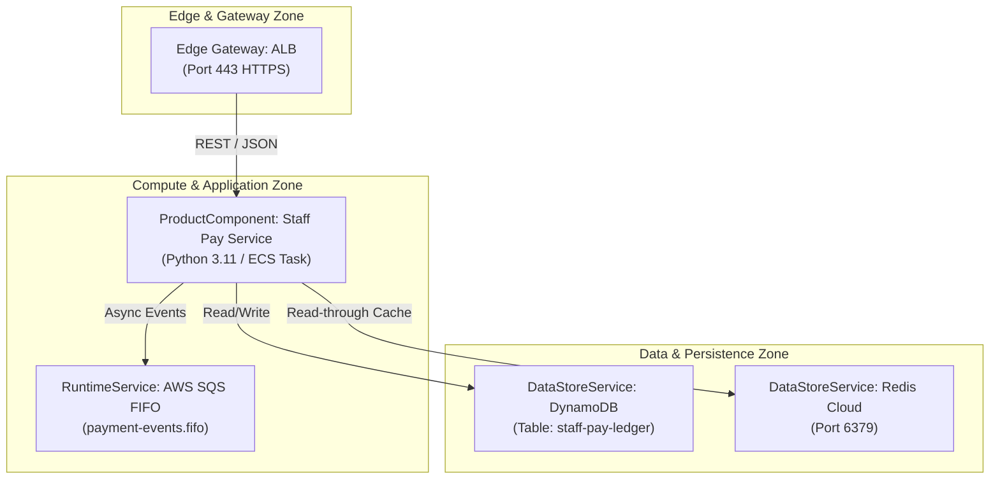

# Draftsman Architecture Diagramming Skill

## Purpose
Enables the Draftsman Agent to parse DRAFT catalog YAML objects (`software_deployment_pattern`, `product_component`, `runtime_service`, `data_store_service`, `edge_gateway_service`) and render visual architectural diagrams in standard Mermaid.js markdown syntax.

## Supported Diagram Types

1. **Deployment Topology Flowchart (`flowchart TD / LR`)**:
   - Visualizes network zone boundaries (Edge, App Zone, Data Zone).
   - Shows connections between gateways, compute runtimes, queues, and databases.
2. **Service Interaction Sequence Diagram (`sequenceDiagram`)**:
   - Visualizes request/response flows between microservices, messaging queues, and data stores.
3. **Component Architecture Diagram (C4 Component)**:
   - Displays internal interfaces, exposed APIs, and technology stack choices for a single `product_component`.

---

## Diagram Generation Rules

1. **Always Use Standard Mermaid Syntax**:
   - Wrap output in triple backticks with language identifier `mermaid`.
   - Quote node labels containing special characters: `id["API Gateway (Port 443)"]`.
2. **Represent Network Subgraph Boundaries**:
   - Use `subgraph` blocks to visually segregate network zones:
     - `subgraph Edge ["Edge / Boundary Zone"]`
     - `subgraph Application ["Compute & Runtime Zone"]`
     - `subgraph Data ["Data & Storage Zone"]`
3. **Include Key Technical Details**:
   - Label arrows with protocols/ports: `ALB -->|HTTPS :443| ServiceA`
   - Indicate data direction: `ServiceA -->|Write / TLS| DynamoDB`

---

## Example Mermaid Output



---

## Rendered Diagram Pages (visual output)

Mermaid and C4 output is text. When the user asks to *see* an architecture,
says they cannot follow text or Mermaid, or wants a page they can open, refresh
and share, render a diagram page instead of hand-writing Mermaid.

Use the deterministic generator. Do not hand-draw the SVG: layouts drawn by hand
differ from run to run and cannot be tested.

```bash
python3 framework/tools/generate_diagram.py --list [--workspace PATH]
python3 framework/tools/generate_diagram.py --sdp "<name, alias or uid>" [--workspace PATH] [--output FILE] [--placed-only]
```

When the framework is vendored into a workspace, run it from the vendored copy
(`.draft/framework/tools/generate_diagram.py`) with the workspace root as
`--workspace`.

The page it writes is one self-contained HTML file with an inline SVG, light and
dark themes, no external requests, and these sections: deployment topology,
recorded relationships, recorded characteristics, open questions from Drafting
Sessions that target the pattern, and a filterable component inventory.

### Rules (the page is only as trustworthy as these)

1. **Document, do not infer.** Zones come from `serviceGroups` and are labelled
   with their recorded `deploymentTarget`. Boxes are placed deployable objects.
   Arrows are `relationship` objects (including inline relationships such as
   `runsOn`) and nothing else. A component with no recorded relationship has no
   arrow. Never add a box or arrow because it seems likely.
2. **Show gaps instead of hiding them.** Components that have a relationship
   but are not placed in a service group are drawn in a separate "Not placed in
   a service group" zone. Retired and deprecated components stay on the page,
   styled as such.
3. **Report conflicts, do not resolve them.** If two recorded fields disagree
   (for example a description says one host and `runsOn` says another), say so
   in your reply to the user, quote both values, and do not pick one.
4. **Use the user's scope.** If several deployment patterns exist, run `--list`
   and ask which one. Do not guess.
5. **Check the result.** Confirm the command reported the expected relationship
   count and read any `warning:` lines (unknown uids referenced by a service
   group) back to the user.

### Delivering the page

- In an environment with an Artifact or page-publishing tool (for example
  Claude Code), publish the generated HTML file so the user gets a link they can
  refresh. Republish to the same location after each regeneration.
- Otherwise give the user the output file path and tell them to open it in a
  browser.
- Hovering or focusing a box highlights its relationships and clicking pins the
  highlight. Mention this when the diagram has more than a few arrows, because
  edge labels are hidden until a box is selected once there are more than eight.
- Offer the Mermaid or C4 output above only when the user wants text to embed in
  Markdown or Confluence.
