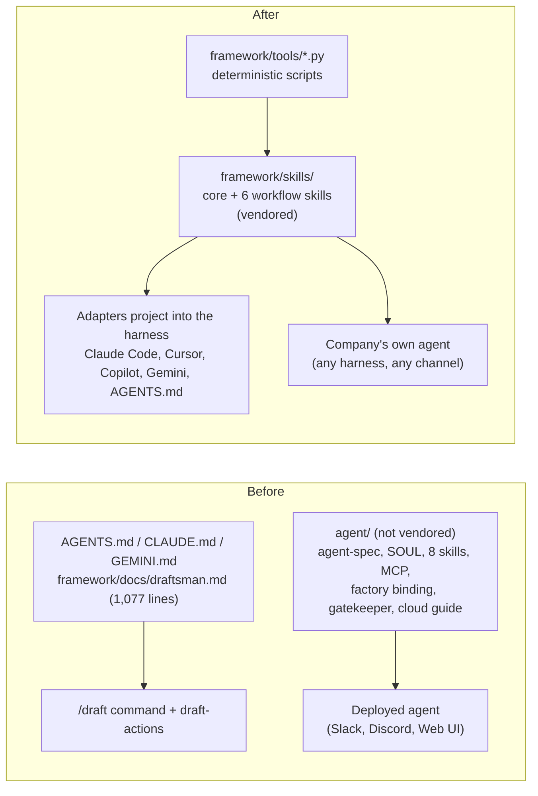

# RFC: Ship the Draftsman as a Portable Skill Pack, Not a Deployed Agent

**Status**: Draft for discussion
**Target Version**: DRAFT v1.3 (`agent/` and the chat integrations are removed in the same release)
**Authors**: Draft prepared for Dale Sackrider

---

## 1. Summary

Today the Draftsman ships in two forms that overlap and have drifted apart:

1. A **repo-first bootstrap** (`AGENTS.md`, `CLAUDE.md`, `GEMINI.md`, `framework/docs/draftsman.md`, the `/draft` command and its action files). It works in any AI tool and is vendored into every company workspace.
2. A **packaged service agent** (`agent/`): an `agent-spec.yaml`, a `SOUL.md`, eight skills, an MCP server, a factory binding, a CI gatekeeper workflow, and a cloud deployment guide. It is not vendored, and it exists to be deployed as a running agent.

This RFC proposes making the skills the product. The Draftsman becomes a **skill pack**: a small set of harness-neutral skills, backed by deterministic scripts the framework already contains, that a company drops into whatever agent or AI tool it already uses. No agent has to be deployed, no secrets are provisioned by DRAFT, and no proprietary agent harness is required or assumed.

DRAFT stops owning any runtime. Everything built to deliver a hosted agent (chat-channel integrations, factory bindings, deployment guides, infrastructure examples, the gatekeeper workflow) is removed, not relocated.

---

## 2. Problem Statement

Facts about the repository as of `main`:

1. **Adopting a company's own agent means adopting ours.** The only packaged route to the `agent/` skills is the factory deployment described in `agent/docs/DEPLOYMENT.md` (a cloud container deployment), with an Anthropic API key and optional Slack and Discord tokens. A company with its own agent platform has no supported way to take the skills without the runtime.
2. **The skills are not distributed.** `agent/` is outside the vendored `.draft/framework` payload, so a workspace refresh does not deliver them. Workspaces receive `framework/docs/draftsman.md` (1,077 lines) and the `/draft` action files instead.
3. **Two sources of truth for identity and behavior.** `agent/SOUL.md` (76 lines) and `framework/docs/soul.md` (135 lines) are both present and differ. The Evidence Discipline rules from #191 live only in `agent/SOUL.md`, and the `draftsman` skill defers to them ("Apply Evidence Discipline (`SOUL.md`)"). A company that takes the skills without `SOUL.md` silently loses the rules that stop the agent presenting inference as recorded fact.
4. **Skills are written for one harness.** They branch on "Central Chat Channels (Slack, Discord, Web UI, Webhooks)" versus "Connected IDEs", and `agent-spec.yaml` carries channel flags, CPU and memory limits, secret names, and iteration limits. None of that is architecture knowledge. It is residue from trying to deliver a fully functional agent, which is the thing this RFC removes.
5. **Company-specific content is in the upstream pack.** `switch-game-architect` is a single company's skill, and `draftsman-engineering-maturity` names specific company agents (Archie, Switch). Neither belongs in a product that every adopter receives.
6. **The MCP server is the only portable interface, and it is narrow.** `agent/mcp/server.py` exposes four tools (`query_architecture`, `get_c4_diagram`, `check_compliance`, `validate_yaml_object`) over a pre-built index. It does not cover authoring, review, or framework update, which are the actions the repo-first bootstrap already handles through scripts.

The result is that the harness-independent form of the Draftsman (the repo bootstrap) is the one adopters actually get, while the form that has the better-factored skills is the one that needs infrastructure.

---

## 3. Goals and Non-Goals

### Goals

- A company can give **any** agent the Draftsman capability by copying or vendoring files. No DRAFT-operated service, container, or secret.
- One source of truth for identity, evidence discipline, and each workflow.
- Skills carry **no harness assumptions**: no channel names, no runtime limits, no credentials.
- Skills reach adopters through the existing `.draft/framework` vendoring and `draft update` path.
- Deterministic work stays in scripts. Skills decide *what to do and how to talk about it*; scripts do the validating, indexing, and rendering.
- Behavior is testable without a model in the loop wherever possible.

### Non-Goals

- Defining a new skill format. This RFC uses the `SKILL.md` convention already in `agent/skills/` (frontmatter with `name` and `description`, markdown body, optional supporting files) and adds adapters for harnesses that lack native support.
- Removing the MCP server. It becomes an optional adapter (see 4.4).
- Changing the DRAFT object model, schemas, or validation.
- Replacing company-run chat agents. This RFC makes them easier to build, not unnecessary.

---

## 4. Proposal

### 4.1 One skill pack, one location

Move the skills to `framework/skills/` so they are part of the vendored payload (`.draft/framework/skills/` in a company workspace). `framework/` is already what `draft update` refreshes, so skills arrive and upgrade with the rest of the framework.

### 4.2 The skills

| Skill | Replaces | Contents |
| :--- | :--- | :--- |
| `draftsman-core` | `agent/SOUL.md`, `agent/skills/draftsman`, the identity half of `framework/docs/draftsman.md`, `framework/docs/soul.md` | Role, voice, **Evidence Discipline (Recorded / Inferred / Unknown)**, the capability profiles in 4.3, routing to the other skills. Always loaded. Target: under 150 lines, with detail in `references/`. |
| `draftsman-author` | `draft-actions/guide.md`, `agent/skills/draftsman-author`, `draftsman-autodiscover` | Guided DraftingSession, SDP completion interview, autodiscovery, schema-valid authoring, validate loop, PR hygiene. |
| `draftsman-query` | `agent/skills/draftsman-query`, `draftsman-standards` | Catalog Q&A and standards/compliance Q&A. Reads `catalog_indexes.json` / `AI_INDEX.md`. |
| `draftsman-review` | `draft-actions/review.md`, the `/draft review` flow | PR and catalog review for correctness, quality, and security compliance. |
| `draftsman-diagram` | `agent/skills/draftsman-diagram` | Mermaid and C4 output, plus the rendered page from `generate_diagram.py` (see PR #196). |
| `draftsman-maturity` | `agent/skills/draftsman-engineering-maturity` | Engineering maturity rubric and release-readiness guardrails, with company-specific agent names removed. |
| `draftsman-update` | `draft-actions/update.md` | Framework update check and safe upgrade. |

`switch-game-architect` is deleted outright. It is not moved to `community/` or kept as an example. Every mention of Archie and Switch is removed from the remaining skills, and the portability lint in section 5 fails the build if one returns.

Each skill is a folder: `SKILL.md` (short, always-relevant instructions) plus `references/` (long material loaded on demand) and `scripts/` only where a script is not already in `framework/tools/`. Splitting `draftsman.md` into `draftsman-core` plus references keeps the always-loaded text small, which matters for agents with limited context.

The `/draft <verb>` command stays as a thin router. Each verb's action file becomes a pointer to the matching skill, so existing documentation, muscle memory, and the company `CLAUDE.md` files keep working.

### 4.3 Capability profiles replace channel modes

The current "Central Chat Mode" and "Connected IDE Mode" are really two capability levels. Express them that way:

| Profile | The agent can | The agent must |
| :--- | :--- | :--- |
| **Query** | Read the catalog index (`catalog_indexes.json`, `AI_INDEX.md`) | Answer with Evidence Discipline, never author YAML, and send authoring requests to a profile that can. |
| **Author** | Read and write files, run scripts, use git | Validate before concluding, open PRs under the user's identity, never handle credentials itself. |

A skill states which profile it needs. A harness with only read access to an index gets the Query profile automatically because the Author skills cannot run there. Nothing in the skills names Slack, Discord, a runtime, or a secret. Channels are not a DRAFT concept, so the skills have no chat mode and no channel-specific instructions.

### 4.4 Scripts do the deterministic work; MCP is optional

Everything a skill needs to *do* already exists as a script under `framework/tools/` (`validate.py`, `generate_ai_index.py`, `generate_c4.py`, `catalog_indexes.py`; `generate_diagram.py` joins them once PR #196 merges). Skills call these directly through the shell. This is the default path and needs nothing but Python.

For harnesses with no shell access, keep an **optional** MCP adapter that wraps the same scripts. The adapter already exists as `framework/tools/mcp_server.py`, which is kept in place; `agent/mcp/` is deleted rather than moved. It may grow to cover validation and diagram rendering, and is documented as an adapter, not a requirement. It must call the scripts rather than reimplement their logic, so the two paths cannot disagree.

### 4.5 Distribution and harness adapters

The skills directory is the single source. `framework/tools/setup_ide.py` already projects DRAFT commands and rules into Claude Code, Cursor, Windsurf, and GitHub Copilot. Extend it to project the skills:

| Harness | Projection |
| :--- | :--- |
| Claude Code | `.claude/skills/<name>/` (native `SKILL.md`) |
| Cursor | `.cursor/rules/<name>.mdc` generated from each skill |
| Windsurf | Section per skill in `.windsurfrules` (the file `setup_ide.py` already writes) |
| GitHub Copilot | Section per skill in `.github/copilot-instructions.md` |
| Gemini CLI | Import list in `GEMINI.md` |
| Anything else | `AGENTS.md` index pointing at `.draft/framework/skills/*/SKILL.md` |

Projections are **generated, never hand-edited**. `draft update` regenerates them, and the framework lock records a hash of the source skills so drift is detectable.

### 4.6 What is removed

Nothing here is relocated except the skills (4.2); the MCP adapter (`framework/tools/mcp_server.py`, 4.4) and `framework/integrations/cursor/` and `windsurf/` stay in place.

| Item | Disposition |
| :--- | :--- |
| `agent/agent-spec.yaml`, `agent/bindings/hermes/` | Deleted. Runtime, channel, secret, and limit fields have no equivalent in the skill pack by design. |
| `agent/docs/DEPLOYMENT.md` and its infrastructure examples | Deleted. Replaced by the short "Bring your own agent" guide (4.7). No IaC is kept anywhere in the repo. |
| `agent/bindings/github-actions/draft-agent-gatekeeper.yml` | Deleted. It belongs to the agent delivery model, not the Draftsman. Companies keep CI validation through `validate.py` and the existing `templates/github/` workflows. |
| `framework/integrations/slack/`, `framework/integrations/discord/`, and `framework/integrations/README.md` | Deleted. `framework/integrations/cursor/` and `framework/integrations/windsurf/` are kept. |
| `agent/skills/switch-game-architect` | Deleted. |
| `agent/SOUL.md`, `framework/docs/soul.md` | Merged into `draftsman-core`, then deleted. |
| `agent/mcp/` | Deleted. The existing `framework/tools/mcp_server.py` is kept as the optional adapter. |
| `framework/tools/validate.py` agent-package hook and `framework/tools/validate_agent_package.py` | Removed with `agent/`, in the same story that deletes `agent/`, because the check requires `agent/`. `validate_skills.py` replaces it (section 5). |
| `draft_table/repo.py` vendoring list | Extended so `framework/skills/` is vendored into `.draft/framework/skills/` (E4). Skills reach workspaces only after this change. |
| `agent/skills/*` (the rest) | Become `framework/skills/*` per 4.2, with channel and company-agent text removed. |
| `agent/` (directory) | Deleted once the above are done. |

Text that describes the removed delivery model is edited out too: the Slack, Discord, and Web UI mode descriptions in `framework/docs/draftsman.md` and `framework/docs/decentralized-sdp-setup.md`, the `agent/bindings/` paragraph in `README.md`, the `KPF-DFT-004` entry in `KPF.md` and its tests, and `validate_agent_package.py`. CHANGELOG history is left as written.

### 4.7 "Bring your own agent" contract

A short guide in `framework/docs/` tells an adopting company exactly what its agent needs:

1. **Load** `draftsman-core` and the workflow skills it wants (copy, vendor, or use the adapters).
2. **Provide the capabilities** for the profile it wants: file read and Python execution for the Author profile, an index file for the Query profile.
3. **Publish the index** from CI (`generate_ai_index.py` already produces `catalog_indexes.json` and `AI_INDEX.md`) if the agent should answer questions without a checkout.
4. **Keep credentials in the harness.** DRAFT skills never ask for tokens. Whatever the agent can read or write is whatever the harness grants its user.

There is nothing to deploy, no secrets matrix, and no required model vendor.

---

## 5. Validation and Testing

Replace `validate_agent_package.py` with `validate_skills.py`, run in CI:

- Every skill has valid frontmatter and a `description` that states when to use it.
- Size budgets: `draftsman-core` and each `SKILL.md` under a stated line limit, with overflow in `references/`.
- Every relative link and every referenced script path resolves.
- **Portability lint**: fail on harness-specific terms in skill bodies (for example `slack`, `discord`, `hermes`, `fargate`, `ANTHROPIC_API_KEY`, named company agents). The rule that keeps the pack harness-neutral is enforced by a test, not by review.
- Adapter output is regenerated from source in CI and compared, so projections cannot drift.
- **Behavior fixtures**: a small set of recorded question-and-index pairs for Evidence Discipline (a relationship with no label must not be characterized, a missing field must be reported as "not in the index"), runnable against any model, so companies can check their own agent. This follows #191 and does not require a specific vendor.

This also gives #195 a smaller target. The skill pack has no multi-node runtime of its own, so the distributed surface to test shrinks to the existing manifest-sync path and CI.

---

## 6. Compatibility and Migration

- **Schemas and validation**: no change.
- **Company workspaces** that follow the repo-first path keep working. Once E4 vendoring lands, they gain `.draft/framework/skills/` on their next `draft update`, and `/draft` verbs keep their names.
- **Removed content**: `agent/` and the Slack and Discord parts of `framework/integrations/` are deleted in the same release, with no deprecation window, because there are no known deployments of them. The CHANGELOG migration notes say so and tell any unknown consumer to load `framework/skills/` instead.
- **Versioning**: moving skills into `framework/` changes vendored content, so treat the release as a minor bump even though no object contract changes. Confirm with the promote workflow's path rules.
- **Dependency on `beta`**: the unmerged `beta` branch renames "Pattern 2" to "Automated Manifest Synchronization" in the onboarding text. Skills must use whichever name `main` settles on. Land the rename first or write the skills against `beta`'s wording.

### Release model and vendoring

- All work lands on the integration branch `feat/draftsman-skill-pack`, created from `main`. Story PRs target the integration branch only, so `promote-release.yml` (which fires on pushes to `main`) does not cut a release per story.
- A single release PR from the integration branch into `main` is opened at the end and merged by a human, producing one complete release.
- Skills need E4 vendoring: until `draft_table/repo.py` vendors `framework/skills/`, workspaces do not receive the skills. Removing the `validate.py` agent-package hook is separate and happens with the `agent/` deletion (phase 3).

### Phased plan

| Phase | Work | Exit criterion |
| :--- | :--- | :--- |
| 0 | Review and decide on this RFC. | Maintainers agree on location, skill set, and the removal list in 4.6. |
| 1 | Extract `draftsman-core` from `SOUL.md`, `soul.md`, and `draftsman.md`. Strip harness text from the workflow skills. Delete `switch-game-architect` and every Archie and Switch reference. | Portability lint passes on all skills. |
| 2 | Move skills to `framework/skills/`. Extend `setup_ide.py` adapters. Make `/draft` verbs point at skills. Add `validate_skills.py` and the behavior fixtures. Extend the `draft_table/repo.py` vendoring list to include `framework/skills/` (E4). | A fresh workspace refresh delivers working skills in Claude Code and one non-Claude harness. |
| 3 | Publish the bring-your-own-agent guide. Keep the optional MCP adapter (`framework/tools/mcp_server.py`). Delete `agent/` together with the `validate.py` agent-package hook and `validate_agent_package.py` (the check requires `agent/`, so all go in the same story), `framework/integrations/slack/`, `framework/integrations/discord/`, `framework/integrations/README.md`, the gatekeeper, and the Slack and Discord text. | `git grep -i -E "slack\|discord\|hermes\|gatekeeper\|archie\|switch-game"` finds nothing outside CHANGELOG history and this RFC. |

---

## 7. Risks and Alternatives

| Risk | Mitigation |
| :--- | :--- |
| Behavior varies across models and harnesses. | Push deterministic work into scripts; ship behavior fixtures so adopters can test their own agent. |
| Harnesses without shell access cannot run validation. | Optional MCP adapter; the repo's own validation in CI remains the backstop for anything that reaches a PR. |
| Adopters edit generated projections and lose changes on update. | Mark projections as generated, hash the sources in the framework lock, and report drift in `draft update`. |
| Always-loaded context is too large for small agents. | Core skill under a size budget; long material in on-demand `references/`. |
| A skill pack cannot give a chat channel to a company that has none. | Out of scope by design. DRAFT ships skills, not channels. A company that wants a chat agent builds it on its own platform. |

### Alternatives considered

- **Keep `agent/` and improve the deployment guide.** Leaves the adopter dependent on our runtime and keeps two sources of truth.
- **One monolithic skill.** Simplest to ship, but it loads everything on every task and cannot be partially adopted. The set in 4.2 lets a company take only `draftsman-query`.
- **MCP-only.** Portable in principle, but it covers only four read-oriented tools and needs a server process. Scripts plus optional MCP is a superset.
- **Do nothing.** The repo-first bootstrap already works everywhere, but the better-factored skills and the Evidence Discipline rules stay unreachable without a deployment.

---

## 8. Open Questions

1. **Location**: `framework/skills/` (vendored automatically) or a top-level `skills/` (clearer for non-DRAFT consumers, needs the vendoring list extended)?
2. **Unknown consumers**: this RFC assumes nothing external uses `agent/` or `framework/integrations/`. Is a CHANGELOG notice enough, or does anyone need a heads-up first?
3. **Adapter priority**: which harnesses must be supported at launch? Claude Code and a generic `AGENTS.md` index are the minimum.
4. **Skill granularity**: should `draftsman-query` and the standards Q&A stay merged, as proposed, or split so a company can adopt standards answers without catalog Q&A?
5. **Identity text**: `agent/SOUL.md` and `framework/docs/soul.md` differ. Which wording is canonical for `draftsman-core`?
6. **Behavior fixtures**: ship them in this repo, or in a separate conformance repo companies can reuse?
