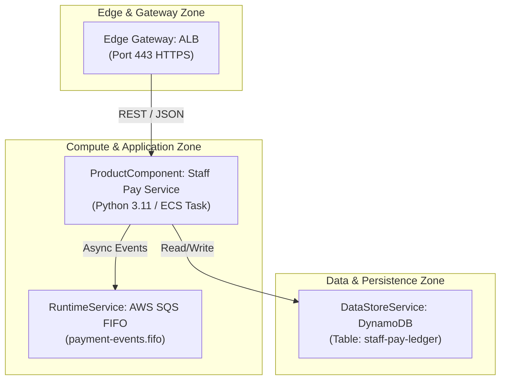

# Mermaid and C4 output

Use this only when the user wants text rather than a rendered page. Everything drawn must come from catalog fields you read (R1); label what you inferred.

## Supported diagrams

1. **Deployment topology flowchart (`flowchart TD` or `LR`).** Network zone boundaries (edge, application, data) and the connections between gateways, compute runtimes, queues and databases.
2. **Service interaction sequence (`sequenceDiagram`).** Request and response flows between services, queues and data stores.
3. **Component diagram (C4).** Interfaces, exposed APIs and technology choices for one `product_component`.

Source objects: `software_deployment_pattern`, `product_component`, `runtime_service`, `data_store_service`, `edge_gateway_service`.

## Rules

1. Wrap output in a fenced block with the language `mermaid`. Quote labels that contain special characters: `id["API Gateway (Port 443)"]`.
2. Use `subgraph` blocks for zones, for example `subgraph Edge ["Edge / Boundary Zone"]`.
3. Label arrows with the recorded protocol or port, for example `ALB -->|HTTPS :443| ServiceA`, and show data direction. If the catalog does not record a protocol or port, leave the label off; do not guess one.

## Example

